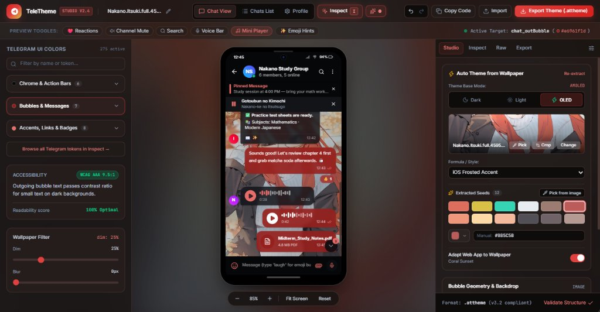
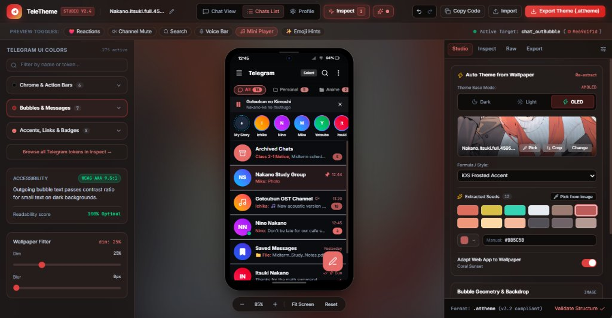
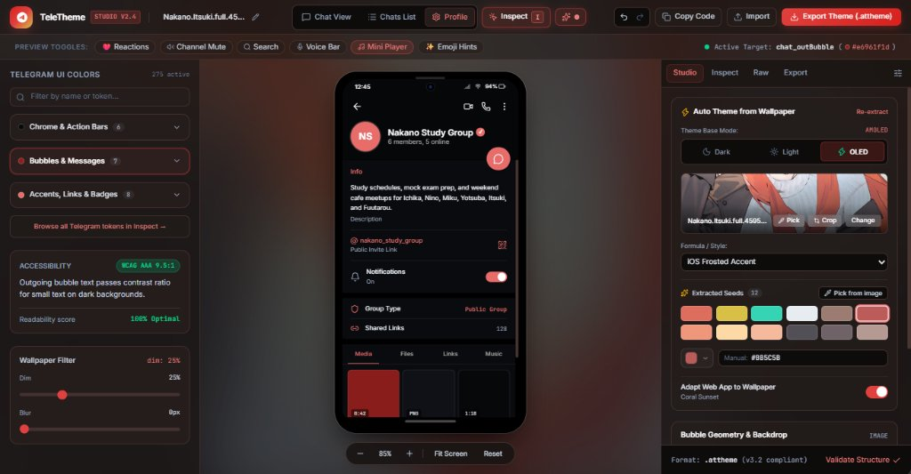

# Nakano Telegram Theme Editor

**Live App:** [https://telegram-theme-editor-webapp.vercel.app/](https://telegram-theme-editor-webapp.vercel.app/)

Graphic design and Photoshop have been a hobby of mine for a while, so naturally I love messing around with shapes and colors. Telegram gives you a ridiculous amount of freedom to recolor almost everything in the app, which hooked me immediately.

The annoying part was how complicated it actually is to make a theme from scratch. For a long time the easiest route was just grabbing themes people posted in Telegram groups (genuinely appreciate those creators), until I stumbled across an Android app that made theming way easier for casual users.

I used that app for a bit, but even after exporting a theme from it I still had to go back into Telegram's built-in editor to fix random things. And as usual, digging through hundreds of cryptic variable names gave me a headache. At some point I remembered Antigravity was right there (not the first time I've used it to build a personal tool), so I spent about a month wrestling with it to put this web app together until it hit a "good enough" point that anyone can just open and use from their browser.

I'm officially too lazy to keep maintaining or tweaking it from here on out, so do whatever you want with it.

Right now it only supports Android theme formats: regular Telegram (`.attheme`) and Telegram X (`.tgx-theme`, minus embedded photo wallpapers since I never found a clean way to do that). As for Telegram Desktop, maybe I'll think about it later.

---

## Previews

**Chat View**


**Chats List**


**Profile View**


---

## Features

- **Works on PC & Phones:** The app has a mobile layout too. You can open [the live web app](https://telegram-theme-editor-webapp.vercel.app/) straight from your phone's browser without needing a PC, or run it locally on your PC and open it from your phone over the same Wi-Fi network.
- **Free Image Selection:** Upload or drag and drop any wallpaper image, with a built-in crop/rotate tool if you want to frame it first.
- **Auto Color Generation (with manual control):** Pulls a palette straight from your wallpaper and builds a matching theme around it using different style formulas (`Material You Monet`, `iOS Frosted Accent`, `High Saturation`, `Pastel Soft`, `Duo-Tone Expressive`, `Deep Atmospheric`), across **Dark**, **Light**, or **OLED** modes. You can still tweak any seed color or type a hex code manually.
- **Wallpaper Eyedropper:** Open the full image with a zoomed pixel loupe to pick the exact color you want directly off your wallpaper.
- **Live Phone Preview:** Test messages, switch between Chat View, Chats List, and Profile, and preview how everything looks in real time.
- **Import & Export:** Load existing `.attheme` files to edit them, or export ready-to-use `.attheme` (with wallpaper attached) and `.tgx-theme` files.

---

## Known Issues & Limitations

- **Color bugs:** Some UI elements or edge-case contrast combinations still look off or don't map cleanly and may need a manual tweak.
- **No Telegram Desktop support:** Only Android formats (`.attheme` and `.tgx-theme`) are supported right now.
- **No embedded photo wallpapers for Telegram X:** `.tgx-theme` is a plain-text format and can't store raw image files like `.attheme` does. You'll either need to set your chat wallpaper manually inside Telegram X, or paste a `t.me/bg/...` cloud wallpaper link in the Export window.

---

## Quick Guide for Casual Users (Just Use the Studio Tab)

If you just want a clean theme without touching code or weird variable names, stay in the **Studio** tab and ignore everything else:

1. **Drop in a photo:** Drag an image onto the wallpaper box (or click **Change**) and crop it if needed.
2. **Pick a base mode:** Choose **Dark**, **Light**, or **OLED**.
3. **Pick a vibe:** Try a different **Formula / Style** from the dropdown, tap through the **Extracted Seeds** color squares, or hit **Pick** / **Pick from image** to grab a specific color from your photo with the eyedropper.
4. **Adjust the backdrop & bubbles (optional):** Switch between **Solid**, **Gradient**, **Dots**, or **Photo**, and tweak blur, dim, bubble corner roundness, opacity, or message tails.
5. **Export:** Hit **Export** at the top, download your `.attheme` (or `.tgx-theme`) file, and apply it in Telegram.

---

## For the Nerds (The Other Tabs)

If you actually want to micromanage every pixel of the Telegram UI:

- **Color Rail / Colors Tab** (left side on desktop, **Colors** tab on smaller screens): Quick-access editor for the main chrome, message bubbles, timestamps, checks, and accent tokens.
- **Inspect Mode & Inspect Tab:** Turn on **Inspect** in the top bar and click directly on any part of the phone mockup (a bubble, header, badge, reply bar, etc.) to jump straight to that exact Telegram variable. Or open the **Inspect** tab to search and browse variables by section.
- **Raw Tab:** View, edit, copy, or paste raw `key=value` `.attheme` code directly, switch between signed 32-bit ARGB integers and hex values, add custom variables manually, or run a quick structure/contrast check.
- **Export Tab / Modal:** Switch between `.attheme` and `.tgx-theme`, copy raw output, download the processed wallpaper `.jpg` on its own, grab a `.zip` package, or attach a `t.me/bg/...` link for Telegram X.
- **Preview Toggles:** Use the pills under the top bar to toggle reactions, muted channel state, search bar, voice note bar, mini audio player, and emoji hints in the phone preview.

---

## How to Apply a Theme on Android

1. Download your `.attheme` (or `.tgx-theme`) file from the **Export** window.
2. Open Telegram (or Telegram X) on your phone and send the file to **Saved Messages**.
3. Tap the file in the chat and select **Apply Theme**.

---

## Running Locally on PC (and Using It on Your Phone)

Make sure you have [Node.js](https://nodejs.org/) installed first.

1. Download the project:
   - Either clone it with Git:
     ```bash
     git clone https://github.com/motsouzumaki/nakano-telegram-theme-editor.git
     cd nakano-telegram-theme-editor
     ```
   - Or click **Code -> Download ZIP** on GitHub, extract it, and open a terminal inside the folder.

2. Install dependencies:
   ```bash
   npm install
   ```

3. Start the app:
   ```bash
   npm run dev
   ```
   Open the `Local` URL printed in your terminal (e.g. `http://localhost:xxxx`, defaulting to `5173` if free) in your PC browser.

4. **To open it on your phone over Wi-Fi:**
   Because `vite.config.ts` already enables network access (`host: true`), Vite will also print a `Network` URL (something like `http://192.168.x.x:xxxx`). Make sure your phone is on the same Wi-Fi as your PC and open that `Network` link in your phone's browser.

To build static production files for hosting (Vercel, Netlify, etc.):

```bash
npm run build
```

The production output is generated in `dist/`.
